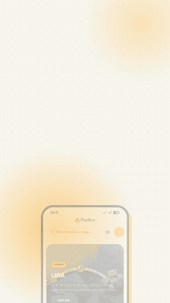
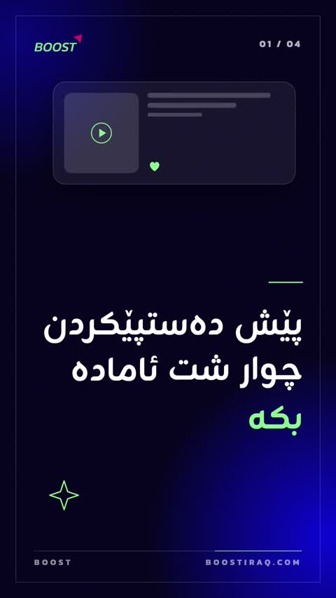
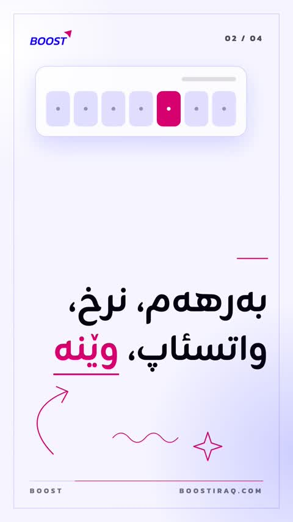
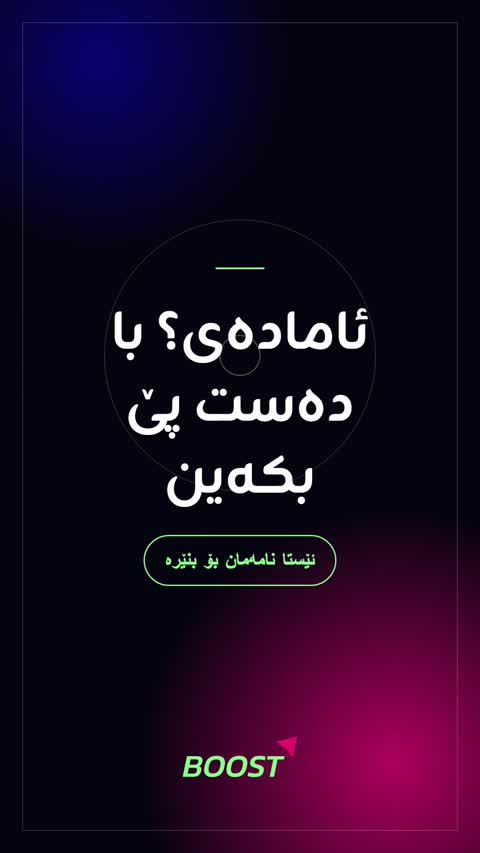
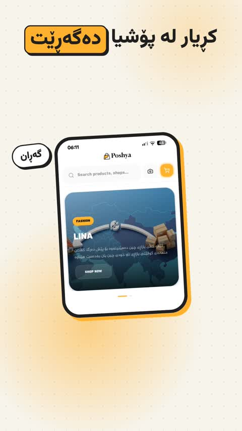
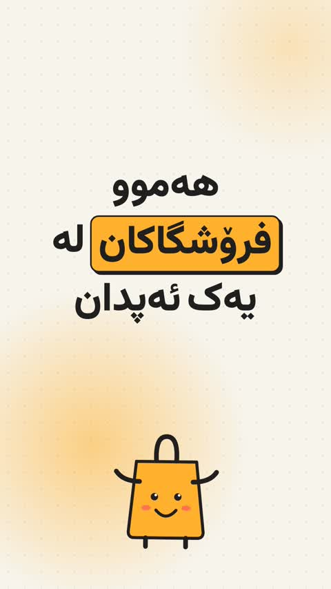
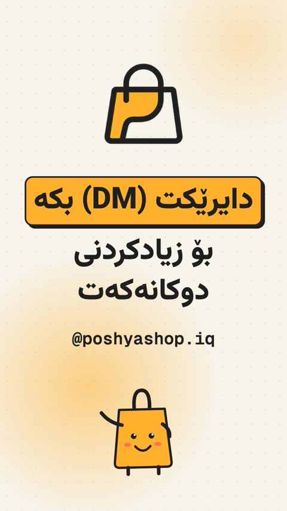

<p align="center">
  
</p>

<p align="center">
  <a href="#quick-start">Quick start</a> ·
  <a href="#skills">Skills</a> ·
  <a href="#retention-gates">Retention</a> ·
  <a href="#three-ways-to-work">Modes</a> ·
  <a href="#video-templates">Video</a> ·
  <a href="#contributing">Contributing</a> ·
  <a href="https://boostiraq.com">Boost Iraq</a>
</p>

<p align="center">
  <a href="LICENSE"></a>
  
  
  
  
</p>

---

## What is Boost Studio

Boost Studio is a **content toolkit for small businesses in Kurdistan and Iraq**. It turns Claude Code into a small content studio: research what works, write the hook and script, lint the caption, build a 9:16 video, **check that people will watch it to the end**, and (only if you want) publish.

It is a folder of **Claude Code skills plus small scripts**, with one folder per brand so each brand keeps its own voice, colours and rules. Kurdish (Sorani) and Arabic, right to left, are first-class, not an afterthought.

*A product of [Boost Iraq](https://boostiraq.com), a Meta-ads agency for local businesses.*

---

## See it

Real reels made and posted with this toolkit, 9:16, Kurdish Sorani, right to left. Both are the latest results at the time of writing.

<table>
<tr>
<td width="50%" align="center" valign="top">
<b>Boost</b> · ad-agency tips<br/><br/>

</td>
<td width="50%" align="center" valign="top">
<b>Poshya</b> · fashion marketplace app<br/><br/>

</td>
</tr>
<tr>
<td align="center" valign="top">
  <br/>
<sub>hook · story · call to action</sub>
</td>
<td align="center" valign="top">
  <br/>
<sub>hook · story · call to action</sub>
</td>
</tr>
</table>

Each one follows the same shape: **hook** in the first two seconds, a short **story**, one **call to action**. The GIFs show the first 12 seconds.

The `starter-story` template (neutral, no brand) is the one you get in the repo. Change the text, colours and brand name in one file (`src/brand.ts`) and render.

<p align="center">
  
</p>

---

## How it works

<p align="center">
  
</p>

Each step is its own skill, so you can use one, some, or all of them.

### Three ways to work

| Mode | Who posts | When to use |
|---|---|---|
| **manual** | you | default; nothing leaves your computer |
| **assisted** | you | Claude lints the caption and shows the exact post first |
| **scheduled** | PostZen, after your "yes" on each post | when you want posts queued |

Nothing is ever posted without your explicit yes on the exact preview.

---

## Skills

| Skill | What it does |
|---|---|
| `studio-start` | Picks the brand and the mode, then routes the request |
| `studio-brief` | One round of questions, then a style board: 3 samples per choice (style, colour, layout, text, animation, speed, sound) so the owner picks by looking, not describing |
| `studio-research` | Reads public pages, YouTube and GitHub without logging in to any account |
| `studio-script` | Three hook options from 12 original formulas, a script, a timed beat sheet |
| `studio-caption` | Writes the caption and lints it (visible text before "... more", dashes, hashtags, forbidden claims) |
| `studio-plan` | A week of posts: format, idea, hook, asset, status |
| `studio-retention` | Plans the story so viewers reach the last shot: open loop, beat map, one short ask. Includes four retention gates (see below) |
| `studio-video` | Builds 9:16 videos: [lemo-opuscar](https://github.com/lemomo-ai/lemo-opuscar) styles first, in the brand's colours; Remotion for phone-UI templates, overlays and assembly |
| `studio-review` | Checks a finished render before you see it: size, duration, black frames, freezes, loudness, safe-area frame sheet |
| `studio-transcribe` | Transcribes and cuts your own recordings (optional) |
| `studio-voiceover` | Script to speech in each brand's own voice: Gemini TTS (free tier) or OpenRouter (paid), one take per video, loudness normalized; ElevenLabs optional |
| `studio-experiments` | The 10 ideas x 5 variants test: control plus hook, production, voiceover and whole-concept variants, with a strict win rule |
| `studio-publish` | Manual, assisted or scheduled publishing with an approval gate |

Two read-only judges live in `.claude/agents/` (see [Phase agents](#phase-agents)).

Scripts you can run on their own:

```bash
python3 scripts/lint_caption.py caption.txt --brand brands/<brand>/brand.json
python3 scripts/beat_sheet.py script.txt --target 20
node tools/retention/lint.mjs script.txt --target 20      # tagged script: [hook] [stakes] [turn] [payoff] [cta]
node tools/retention/gate.mjs plan videos/<name>/plan.json
node tools/render-check/check.mjs out/video.mp4 --expect-duration 20
node --env-file=.env.local tools/voiceover/run.mjs script.txt --brand <brand>   # one take in the brand's voice
node tools/styleboard/make.mjs --brand _example --out videos/<name>/styleboard --hook "..."
node tools/experiments/report.mjs brands/<brand>/experiments/<plan>.json
```

---

## Retention gates

A video nobody watches to the end does not help a brand. Four gates score each stage from 0 to 100 (**pass = 80 or more and no failure**). Anything less goes back to the step that caused it, with a concrete fix per finding. After two rounds on the same stage, the skill stops and asks you.

| Gate | Checks | Goes back to |
|---|---|---|
| **G1 script** | hook first, a question open until the payoff, payoff late (about 70-90%), one short ask last | `studio-script` |
| **G2 plan** | scenes and cuts, motion in the first 0.5 s, a change at every turn, quiet stretches, payoff hold, text read time, one emphasis per shot | the shot plan |
| **G3 build** | the same checks on the real timeline before the full render | `studio-video` |
| **G4 render** | measured on the file: cuts, frozen stretches, motion at the start, last frame vs first | `studio-video`, re-render |

Every rule is labelled **platform**, **research**, **vendor** or **hypothesis** in [`skills/studio-retention/references/sources.md`](skills/studio-retention/references/sources.md). Most numbers are rules of thumb from creator guides, not measured facts, so test them on your own analytics (skip rate, retention chart, average watch time, sends per reach). The gates check structure only; they cannot tell you whether the story is good.

---

## Phase agents

Whoever made a reel should not grade it. Two Claude Code sub-agents do the judging, each with its own context and **no Edit or Write tool**: they cannot change the work, post it or spend credits.

| Agent | Judges | Returns |
|---|---|---|
| `retention-checker` | a script (G1), a plan (G2/G3) or a render (G4): runs the gate, then adds what a tool cannot see (a weak hook, a payoff that never lands, text too fast to read) | `PASS`, `REVISE`, `FAIL` or `STOP`, up to 6 fixes, and the step to go back to |
| `reel-reviewer` | a finished reel: render checker, retention gate, loudness, and its own look at the frame sheet (cut-off text, right-to-left shaping, safe areas, brand colours, a call to action on the last frame) | `PASS` or `REVISE` with fixes |

In practice the reviewer caught six visible problems in a reel the gate had passed at 93/100. The brand session still builds the reel; only the judging is split off.

---

## Voice per brand

Each brand keeps its own voice in `brand.json` (`tts`: provider, voice, a style description). `tools/voiceover/run.mjs` generates the whole script as **one take** (one request, same tone across lines), cuts it into lines, and normalizes it to about -16 LUFS. Providers: Gemini TTS on the Google free tier (about 10 requests a day per model) or OpenRouter (paid, a few cents per video, works where Google billing is not available). `tools/gemini-tts/design-voice.mjs` designs a custom voice from a description; `tools/openrouter/usage.mjs` shows what you spent. For Kurdish Sorani, `tools/rastnus/check.mjs` shows corrections before any voice is made and never applies them on its own.

Pick a voice by ear on the same script: one that sounds great in English can pronounce Kurdish badly.

---

## Lessons

Short, concrete things that changed a tool or a rule: [`docs/lessons.md`](docs/lessons.md). For example, Instagram "trial reels" sent through the API are posted as normal public reels, and an editor's render can add glitch frames that the source clips never had.

---

## Quick start

```bash
git clone https://github.com/aeubamen/boost-studio.git
cd boost-studio
./install.sh          # links the skills into ~/.claude/skills and checks your tools
```

1. Copy `brands/_example` to `brands/<your-brand>` and fill in `brand.json` and `voice.md`.
2. Open Claude Code in the folder and try:

```text
/studio-start  make a 20 second reel for my shop
```

**You need:** [Claude Code](https://claude.com/claude-code), Node.js 22+, ffmpeg.
**Optional:** [`uv`](https://docs.astral.sh/uv/) + [Agent-Reach](https://github.com/Panniantong/Agent-Reach) for login-free research, [ai-media-editor](https://github.com/ellmos-ai/ai-media-editor) for transcribing recordings, a [PostZen](https://www.postzen.dev) account for scheduled posting, an [ElevenLabs](https://elevenlabs.io) account for voiceover (see `tools/elevenlabs/README.md`).

### A brand folder

```text
brands/your-brand/
├── brand.json   name, site, colours, font, claims you may make, words you may not
└── voice.md     who you talk to, how you sound, real captions, proof you can use
```

Skills read these files and **never invent** what is missing: no made-up prices, numbers, delivery times or warranty terms. Unknown fields stay `TODO` until you fill them in.

---

## Video templates

`templates/video/starter-story` is a 15-second, 9:16 [Remotion](https://www.remotion.dev) composition: hook card, phone chat, button, end card. Right-to-left text works out of the box.

```bash
cd templates/video/starter-story
npm install
npx remotion still src/index.ts Story out/check.png --frame=100 --scale=0.4
npx remotion render src/index.ts Story out/video.mp4
```

Fonts, logos, product photos and sound effects are not included. Add your own under `public/` (see [`templates/video/AUDIO.md`](templates/video/AUDIO.md)).

---

## Principles

- **Kurdish Sorani first, right to left.** Every Kurdish line is a draft until a native speaker approves it.
- **Real data only.** No invented proof.
- **No logged-in scraping, no password handling.** Research uses public sources.
- **Keys stay out of git.** API keys live only in a git-ignored `.env.local`.
- **You stay in control.** No post goes out without your yes.

---

## Repository layout

```text
brands/_example/                  copy this to start a brand
skills/                           the thirteen studio-* skills
.claude/agents/                   retention-checker and reel-reviewer (read-only judges)
scripts/                          hooks.json, lint_caption.py, beat_sheet.py
tools/elevenlabs/                 optional voiceover script (ElevenLabs)
tools/gemini-tts/ tools/voiceover/  per-brand voice: Gemini or OpenRouter TTS, one take, loudness
tools/openrouter/                 spend monitor for the TTS key
tools/rastnus/                    optional Kurdish Sorani corrector step (local model)
tools/styleboard/                 A/B/C sample board for studio-brief
tools/experiments/                report for the 10 x 5 test
tools/retention/                  lint.mjs (script) and gate.mjs (script, plan, render)
tools/render-check/               check.mjs: automatic review of a finished render
templates/video/starter-story/    neutral Remotion template
docs/                             lessons.md, lemo-brand-styles.md, images used by this README
posts/ plans/ research/ videos/   your working output (git-ignored)
```

---

## Ideas

Not promises, just directions that would be useful:

- An Arabic-first starter template
- More neutral templates: product-to-delivery, app-install demo, before/after
- Better Kurdish hook examples reviewed by native speakers
- Carousel and story skills

---

## Contributing

Issues and pull requests are welcome, especially:

- Kurdish and Arabic wording fixes
- New hook formulas and caption checks
- New neutral video templates

Please read [CONTRIBUTING.md](CONTRIBUTING.md). Do not add logos, fonts, photos or sound you do not have the right to share.

---

## Credits

Boost Studio is original work, inspired by four MIT-licensed projects and, for the render self-review idea, one AGPL project (ideas only, no code). See [NOTICE.md](NOTICE.md).

## License

[MIT](LICENSE) © 2026 Boost Iraq
