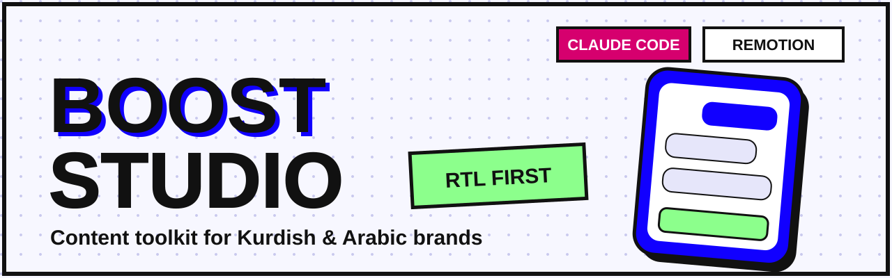
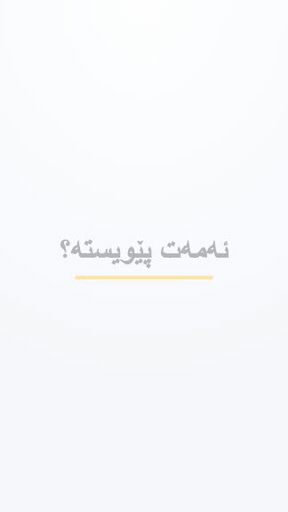
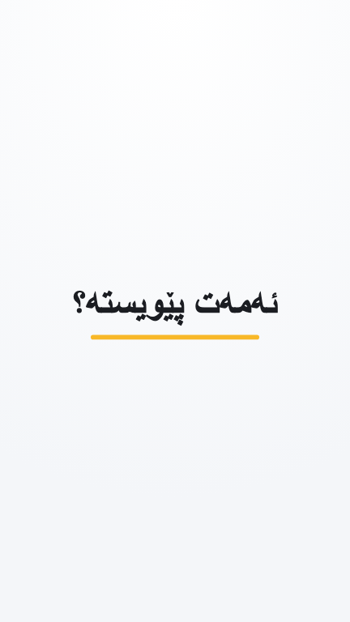
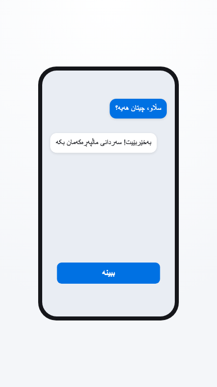
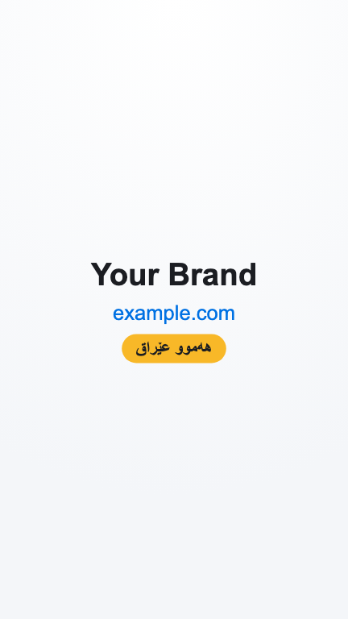
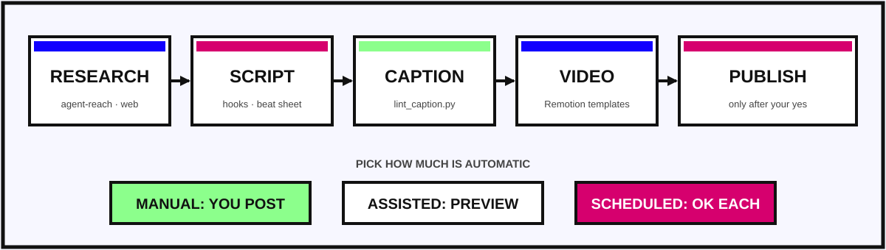

<p align="center">
  
</p>

<p align="center">
  <a href="#quick-start">Quick start</a> ·
  <a href="#skills">Skills</a> ·
  <a href="#three-ways-to-work">Modes</a> ·
  <a href="#video-templates">Video</a> ·
  <a href="#contributing">Contributing</a> ·
  <a href="https://boostiraq.com">Boost Iraq</a>
</p>

<p align="center">
  <a href="LICENSE"></a>
  
  
  
  
</p>

---

## What is Boost Studio

Boost Studio is a **content toolkit for small businesses in Kurdistan and Iraq**. It turns Claude Code into a small content studio: research what works, write the hook and script, lint the caption, build a 9:16 video, and (only if you want) publish.

It is a folder of **Claude Code skills plus small scripts**, with one folder per brand so each brand keeps its own voice, colours and rules. Kurdish (Sorani) and Arabic, right to left, are first-class, not an afterthought.

*A product of [Boost Iraq](https://boostiraq.com), a Meta-ads agency for local businesses.*

---

## See it

<p align="center">
  
</p>

<table>
<tr>
<td width="33%" valign="top"><br/><sub><b>1 · Hook</b>: one clear line in the first two seconds.</sub></td>
<td width="33%" valign="top"><br/><sub><b>2 · Story</b>: a phone chat, a button, a reason to click.</sub></td>
<td width="33%" valign="top"><br/><sub><b>3 · Call to action</b>: name, link, one ask.</sub></td>
</tr>
</table>

The `starter-story` template above is neutral. Change the text, colours and brand name in one file (`src/brand.ts`) and render.

---

## How it works

<p align="center">
  
</p>

Each step is its own skill, so you can use one, some, or all of them.

### Three ways to work

| Mode | Who posts | When to use |
|---|---|---|
| **manual** | you | default; nothing leaves your computer |
| **assisted** | you | Claude lints the caption and shows the exact post first |
| **scheduled** | PostZen, after your "yes" on each post | when you want posts queued |

Nothing is ever posted without your explicit yes on the exact preview.

---

## Skills

| Skill | What it does |
|---|---|
| `studio-start` | Picks the brand and the mode, then routes the request |
| `studio-research` | Reads public pages, YouTube and GitHub without logging in to any account |
| `studio-script` | Three hook options from 12 original formulas, a script, a timed beat sheet |
| `studio-caption` | Writes the caption and lints it (visible text before "... more", dashes, hashtags, forbidden claims) |
| `studio-plan` | A week of posts: format, idea, hook, asset, status |
| `studio-video` | Builds and renders 9:16 motion videos from the Remotion templates |
| `studio-transcribe` | Transcribes and cuts your own recordings (optional) |
| `studio-publish` | Manual, assisted or scheduled publishing with an approval gate |

Scripts you can run on their own:

```bash
python3 scripts/lint_caption.py caption.txt --brand brands/<brand>/brand.json
python3 scripts/beat_sheet.py script.txt --target 20
```

---

## Quick start

```bash
git clone https://github.com/aeubamen/boost-studio.git
cd boost-studio
./install.sh          # links the skills into ~/.claude/skills and checks your tools
```

1. Copy `brands/_example` to `brands/<your-brand>` and fill in `brand.json` and `voice.md`.
2. Open Claude Code in the folder and try:

```text
/studio-start  make a 20 second reel for my shop
```

**You need:** [Claude Code](https://claude.com/claude-code), Node.js 22+, ffmpeg.
**Optional:** [`uv`](https://docs.astral.sh/uv/) + [Agent-Reach](https://github.com/Panniantong/Agent-Reach) for login-free research, [ai-media-editor](https://github.com/ellmos-ai/ai-media-editor) for transcribing recordings, a [PostZen](https://www.postzen.dev) account for scheduled posting.

### A brand folder

```text
brands/your-brand/
├── brand.json   name, site, colours, font, claims you may make, words you may not
└── voice.md     who you talk to, how you sound, real captions, proof you can use
```

Skills read these files and **never invent** what is missing: no made-up prices, numbers, delivery times or warranty terms. Unknown fields stay `TODO` until you fill them in.

---

## Video templates

`templates/video/starter-story` is a 15-second, 9:16 [Remotion](https://www.remotion.dev) composition: hook card, phone chat, button, end card. Right-to-left text works out of the box.

```bash
cd templates/video/starter-story
npm install
npx remotion still src/index.ts Story out/check.png --frame=100 --scale=0.4
npx remotion render src/index.ts Story out/video.mp4
```

Fonts, logos, product photos and sound effects are not included. Add your own under `public/` (see [`templates/video/AUDIO.md`](templates/video/AUDIO.md)).

---

## Principles

- **Kurdish Sorani first, right to left.** Every Kurdish line is a draft until a native speaker approves it.
- **Real data only.** No invented proof.
- **No logged-in scraping, no password handling.** Research uses public sources.
- **You stay in control.** No post goes out without your yes.

---

## Repository layout

```text
brands/_example/                  copy this to start a brand
skills/                           the eight studio-* skills
scripts/                          hooks.json, lint_caption.py, beat_sheet.py
templates/video/starter-story/    neutral Remotion template
docs/assets/                      images used by this README
posts/ plans/ research/ videos/   your working output (git-ignored)
```

---

## Ideas

Not promises, just directions that would be useful:

- An Arabic-first starter template
- More neutral templates: product-to-delivery, app-install demo, before/after
- Better Kurdish hook examples reviewed by native speakers
- Carousel and story skills

---

## Contributing

Issues and pull requests are welcome, especially:

- Kurdish and Arabic wording fixes
- New hook formulas and caption checks
- New neutral video templates

Please read [CONTRIBUTING.md](CONTRIBUTING.md). Do not add logos, fonts, photos or sound you do not have the right to share.

---

## Credits

Boost Studio is original work, inspired by four MIT-licensed projects. See [NOTICE.md](NOTICE.md).

## License

[MIT](LICENSE) © 2026 Boost Iraq
